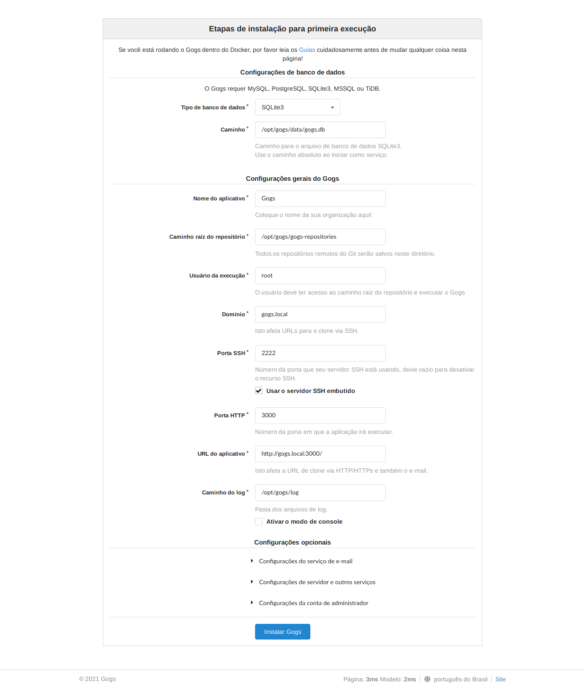
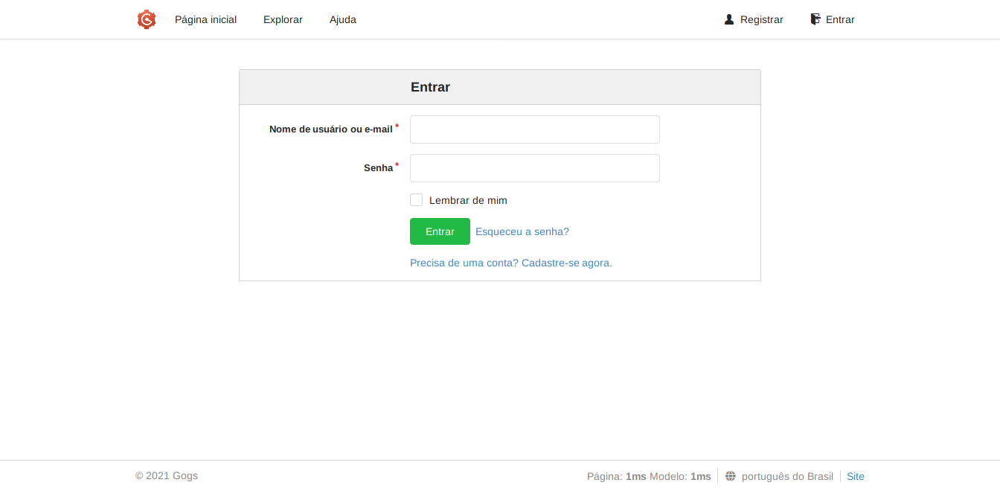
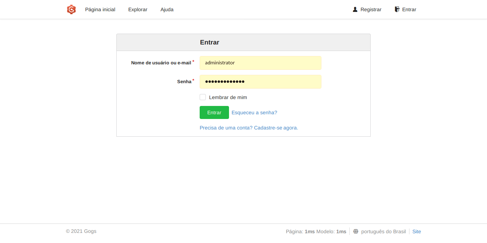
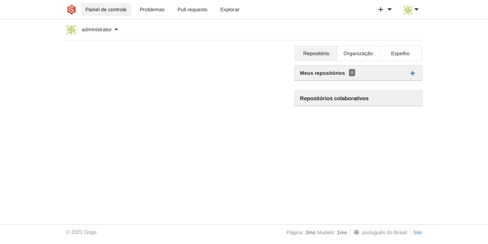
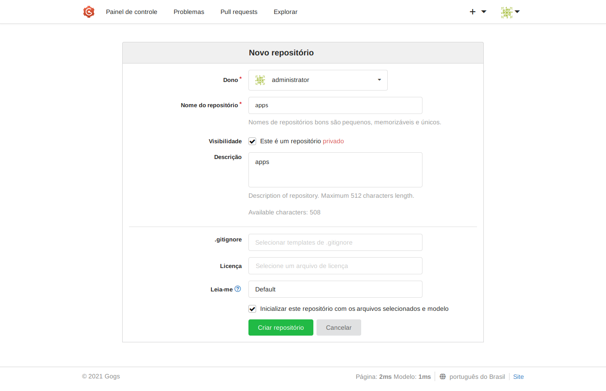
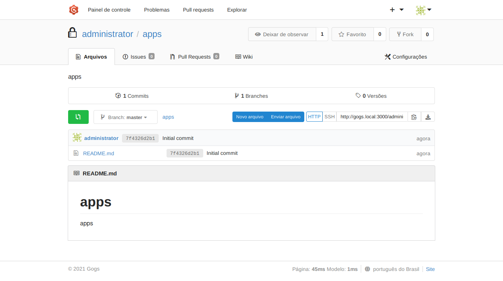
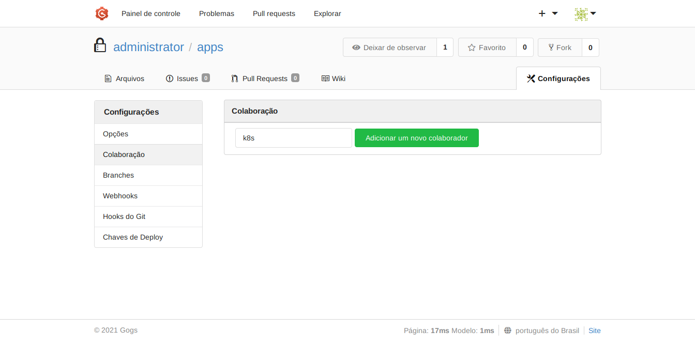
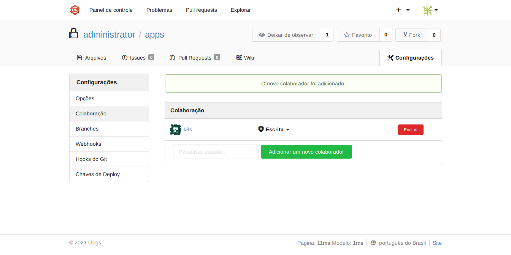

*Read this in other languages: [en-US](README_JENKINS.md), [pt-BR](README_JENKINS.pt-BR.md)*

# Requisitos para esta POC

Nesta POC, usaremos o Multipass para criar instâncias para instalar o Gogs, Microk8s e Jenkins, estabelecendo então o servidor Git como um GitOps para o cluster Kubernetes provisionado com o Microk8s.

## Instale o Multipass

```bash
sudo snap install multipass --classic
```

# MicroK8s

MicroK8s é o Kubernetes menor, mais rápido e totalmente compatível que acompanha as versões upstream e torna o clustering trivial. O MicroK8s é ótimo para desenvolvimento offline, prototipagem e testes.

## Crie um template MicroK8s

```bash
echo '#cloud-config
runcmd:
  - apt update --fix-missing
  - snap refresh
  - snap install microk8s --classic
  - microk8s status --wait-ready
  - microk8s enable dns ingress' > cloud-config-microk8s.yaml
```

## Crie uma instância MicroK8s

```bash
multipass launch focal -n microk8s -c 2 -m 2G -d 10G --cloud-init cloud-config-microk8s.yaml
```

## Exporte a configuração atual do MicroK8s para uso com o Kubectl

### Crie a pasta para armazenar a configuração do cluster Kubernetes na instância

```bash
sudo mkdir -p $HOME/.kube/configs
```

### Exporte a configuração do MicroK8s na instância para a pasta criada

```bash
multipass exec microk8s -- sudo microk8s config > $HOME/.kube/configs/config-microk8s
```

### Use em sua sessão a configuração exportada como padrão para uso com o Kubectl

```bash
export KUBECONFIG=$HOME/.kube/configs/config-microk8s
```

```bash
chmod 0600 $KUBECONFIG
```

### Instale o Kubectl

```bash
sudo snap install kubectl --classic
```

```bash
kubectl get no
```

```txt
NAME       STATUS   ROLES    AGE   VERSION
microk8s   Ready    <none>   59m   v1.21.5-3+83e2bb7ee39726
```

### Adicione um alias de IP da instância microk8s para microk8s.local

```bash
multipass info microk8s | grep IPv4 | cut -f 2 -d ":" | tr -d [:blank:] | sed 's/$/     microk8s.local/' | sudo tee -a /etc/hosts
```

### Adicione um alias de IP da instância microk8s para app01.local, app02.local e app03.local

```bash
multipass info microk8s | grep IPv4 | cut -f 2 -d ":" | tr -d [:blank:] | sed 's/$/     app01.local app02.local app03.local/' | sudo tee -a /etc/hosts
```

### URL para microk8s.local

<http://microk8s.local>

## Instale o Gogs

# Gogs

Gogs é um serviço Git auto-hospedado indolor. Este projeto visa construir um serviço Git auto-hospedado simples, estável e extensível que pode ser configurado da maneira mais indolor possível.

## Crie um cloud-init para a instância Gogs com Multipass

```bash
echo '#cloud-config
write_files:
  - path: /etc/rc.local
    owner: root:root
    permissions: 0777
    content: |
      #!/bin/bash
      exec sudo /opt/gogs/gogs web &
      exit 0
    append: true
  - path: /opt/gogs/custom/conf/app.ini
    owner: root:root
    permissions: 0777
    content: |
      BRAND_NAME = Gogs
      RUN_USER   = root
      RUN_MODE   = prod

      [database]
      TYPE     = sqlite3
      HOST     = 127.0.0.1:5432
      NAME     = gogs
      USER     = gogs
      PASSWORD =
      SSL_MODE = disable
      PATH     = data/gogs.db

      [repository]
      ROOT = /opt/gogs/gogs-repositories

      [server]
      DOMAIN           = gogs.local
      HTTP_PORT        = 3000
      EXTERNAL_URL     = http://gogs.local:3000/
      DISABLE_SSH      = false
      SSH_PORT         = 2222
      START_SSH_SERVER = true
      OFFLINE_MODE     = false

      [mailer]
      ENABLED = false

      [service]
      REGISTER_EMAIL_CONFIRM = false
      ENABLE_NOTIFY_MAIL     = false
      DISABLE_REGISTRATION   = false
      ENABLE_CAPTCHA         = true
      REQUIRE_SIGNIN_VIEW    = false

      [picture]
      DISABLE_GRAVATAR        = false
      ENABLE_FEDERATED_AVATAR = false

      [session]
      PROVIDER = file

      [log]
      MODE      = console, file
      LEVEL     = Info
      ROOT_PATH = /opt/gogs/log
    append: true
runcmd:
  - apt update --fix-missing
  - apt -y remove snapd --purge
  - cd /tmp
  - wget -c https://dl.gogs.io/0.12.3/gogs_0.12.3_linux_amd64.tar.gz
  - tar -zxvf gogs_0.12.3_linux_amd64.tar.gz
  - mkdir -p /opt/gogs/
  - chmod u+rxw /opt/gogs
  - cp -raf /tmp/gogs/gogs /opt/gogs/
  - chown -R root:root /opt/gogs
  - /opt/gogs/gogs web &' > cloud-config-gogs.yaml
```

## Crie uma instância Gogs com Multipass

```bash
multipass launch focal -n gogs -c 1 -m 1G -d 5G --cloud-init cloud-config-gogs.yaml
```

## Adicione um alias de IP da instância Gogs para gogs.local

```bash
multipass info gogs | grep IPv4 | cut -f 2 -d ":" | tr -d [:blank:] | sed 's/$/     gogs.local/' | sudo tee -a /etc/hosts
```

### URL para gogs.local

<http://gogs.local>



## Crie usuários **administrator** e **k8s**

```bash
multipass exec gogs -- sudo /opt/gogs/gogs admin create-user --name administrator --password administrator --admin --email administrator@example.com
```

```bash
multipass exec gogs -- sudo /opt/gogs/gogs admin create-user --name k8s --password k8s --email k8s@example.com
```

## Reinicie o Gogs

```bash
multipass exec gogs -- sudo reboot
```

## Acesse o Gogs





## Crie um repositório **apps**





## Adicione o usuário **k8s** ao repositório **apps**







## Crie uma chave SSH (Opcional)

```bash
ssh-keygen -t ed25519 -C "administrator@example.com" -f ssh-key-gogs
```

## Clone o repositório **apps**

```bash
git clone http://gogs.local:3000/administrator/apps.git
```

```text
Cloning into 'apps'...
remote: Enumerating objects: 3, done.
remote: Counting objects: 100% (3/3), done.
remote: Total 3 (delta 0), reused 0 (delta 0)
Unpacking objects: 100% (3/3), 217 bytes | 217.00 KiB/s, done.
```

## Crie apps de exemplo

```bash
cd apps
mkdir -p apps/{app01,app02,app03}
echo "timestamps {

node () {

	stage ('app03 - Checkout') {
 	 checkout([\$class: 'GitSCM', branches: [[name: '*/master']], doGenerateSubmoduleConfigurations: false, extensions: [], submoduleCfg: [], userRemoteConfigs: [[credentialsId: 'k8s', url: 'http://gogs.local:3000/administrator/apps.git']]])
	}
	stage ('app03 - Build') {
 			// Shell build step
sh '''
echo "app03"
curl -LO "https://storage.googleapis.com/kubernetes-release/release/$(curl -s https://storage.googleapis.com/kubernetes-release/release/stable.txt)/bin/linux/amd64/kubectl"
chmod +x ./kubectl
./kubectl get no
./kubectl apply -f apps/app03/app03_list.yaml
  '''
	}
}
}" > apps/app03/Jenkinsfile
echo 'apiVersion: v1
items:
  - apiVersion: v1
    kind: Namespace
    metadata:
      name: app03
  - apiVersion: v1
    data:
      default.conf: |
        server {
            listen       8080;
            listen  [::]:8080;
            server_name  localhost;
            location / {
                root   /usr/share/nginx/html;
                index  index.html index.htm;
            }
            error_page   500 502 503 504  /50x.html;
            location = /50x.html {
                root   /usr/share/nginx/html;
            }
        }
    kind: ConfigMap
    metadata:
      name: app03-config
      namespace: app03
  - apiVersion: apps/v1
    kind: Deployment
    metadata:
      labels:
        app: app03-deployment
      name: app03-deployment
      namespace: app03
    spec:
      replicas: 1
      selector:
        matchLabels:
          app: app03-deployment
      strategy:
        rollingUpdate:
          maxSurge: 25%
          maxUnavailable: 25%
        type: RollingUpdate
      template:
        metadata:
          labels:
            app: app03-deployment
        spec:
          containers:
            - image: nginx:stable
              name: app03-pod
              ports:
                - containerPort: 8080
                  protocol: TCP
              volumeMounts:
                - mountPath: /etc/nginx/conf.d
                  name: app03-config
          dnsPolicy: ClusterFirst
          volumes:
            - configMap:
                name: app03-config
              name: app03-config
  - apiVersion: v1
    kind: Service
    metadata:
      labels:
        app: app03-deployment
      name: app03-service
      namespace: app03
    spec:
      ports:
        - port: 8080
      selector:
        app: app03-deployment
      type: NodePort
  - apiVersion: networking.k8s.io/v1
    kind: Ingress
    metadata:
      name: app03-ingress
      namespace: app03
    spec:
      rules:
        - host: app03.local
          http:
            paths:
              - backend:
                  service:
                    name: app03-service
                    port:
                      number: 8080
                path: /
                pathType: Prefix
kind: List
metadata: {}' > apps/app03/app03_list.yaml
echo 'apiVersion: v1
items:
  - apiVersion: v1
    kind: Namespace
    metadata:
      name: app02
  - apiVersion: v1
    data:
      default.conf: |
        server {
            listen       8080;
            listen  [::]:8080;
            server_name  localhost;
            location / {
                root   /usr/share/nginx/html;
                index  index.html index.htm;
            }
            error_page   500 502 503 504  /50x.html;
            location = /50x.html {
                root   /usr/share/nginx/html;
            }
        }
    kind: ConfigMap
    metadata:
      name: app02-config
      namespace: app02
  - apiVersion: apps/v1
    kind: Deployment
    metadata:
      labels:
        app: app02-deployment
      name: app02-deployment
      namespace: app02
    spec:
      replicas: 1
      selector:
        matchLabels:
          app: app02-deployment
      strategy:
        rollingUpdate:
          maxSurge: 25%
          maxUnavailable: 25%
        type: RollingUpdate
      template:
        metadata:
          labels:
            app: app02-deployment
        spec:
          containers:
            - image: nginx:stable
              name: app02-pod
              ports:
                - containerPort: 8080
                  protocol: TCP
              volumeMounts:
                - mountPath: /etc/nginx/conf.d
                  name: app02-config
          dnsPolicy: ClusterFirst
          volumes:
            - configMap:
                name: app02-config
              name: app02-config
  - apiVersion: v1
    kind: Service
    metadata:
      labels:
        app: app02-deployment
      name: app02-service
      namespace: app02
    spec:
      ports:
        - port: 8080
      selector:
        app: app02-deployment
      type: NodePort
  - apiVersion: networking.k8s.io/v1
    kind: Ingress
    metadata:
      name: app02-ingress
      namespace: app02
    spec:
      rules:
        - host: app02.local
          http:
            paths:
              - backend:
                  service:
                    name: app02-service
                    port:
                      number: 8080
                path: /
                pathType: Prefix
kind: List
metadata: {}' > apps/app02/app02_list.yaml
echo 'apiVersion: v1
items:
  - apiVersion: v1
    kind: Namespace
    metadata:
      name: app01
  - apiVersion: v1
    data:
      default.conf: |
        server {
            listen       8080;
            listen  [::]:8080;
            server_name  localhost;
            location / {
                root   /usr/share/nginx/html;
                index  index.html index.htm;
            }
            error_page   500 502 503 504  /50x.html;
            location = /50x.html {
                root   /usr/share/nginx/html;
            }
        }
    kind: ConfigMap
    metadata:
      name: app01-config
      namespace: app01
  - apiVersion: apps/v1
    kind: Deployment
    metadata:
      labels:
        app: app01-deployment
      name: app01-deployment
      namespace: app01
    spec:
      replicas: 1
      selector:
        matchLabels:
          app: app01-deployment
      strategy:
        rollingUpdate:
          maxSurge: 25%
          maxUnavailable: 25%
        type: RollingUpdate
      template:
        metadata:
          labels:
            app: app01-deployment
        spec:
          containers:
            - image: nginx:stable
              name: app01-pod
              ports:
                - containerPort: 8080
                  protocol: TCP
              volumeMounts:
                - mountPath: /etc/nginx/conf.d
                  name: app01-config
          dnsPolicy: ClusterFirst
          volumes:
            - configMap:
                name: app01-config
              name: app01-config
  - apiVersion: v1
    kind: Service
    metadata:
      labels:
        app: app01-deployment
      name: app01-service
      namespace: app01
    spec:
      ports:
        - port: 8080
      selector:
        app: app01-deployment
      type: NodePort
  - apiVersion: networking.k8s.io/v1
    kind: Ingress
    metadata:
      name: app01-ingress
      namespace: app01
    spec:
      rules:
        - host: app01.local
          http:
            paths:
              - backend:
                  service:
                    name: app01-service
                    port:
                      number: 8080
                path: /
                pathType: Prefix
kind: List
metadata: {}' > apps/app01/app01_list.yaml
```

```bash
git config --local user.name k8s
git config --local user.email k8s@example.com
git add -A
git commit -m "apps"
```

```text
[master 73c8510] apps
 4 files changed, 301 insertions(+)
 create mode 100644 apps/app01/app01_list.yaml
 create mode 100644 apps/app02/app02_list.yaml
 create mode 100644 apps/app03/Jenkinsfile
 create mode 100644 apps/app03/app03_list.yaml
```

```bash
git push
```

```text
Enumerating objects: 11, done.
Counting objects: 100% (11/11), done.
Delta compression using up to 8 threads
Compressing objects: 100% (8/8), done.
Writing objects: 100% (10/10), 1.76 KiB | 1.76 MiB/s, done.
Total 10 (delta 2), reused 0 (delta 0)
To http://gogs.local:3000/administrator/apps.git
   6428dda..73c8510  master -> master
```

## Instale o Jenkins

# Jenkins

O servidor de automação de código aberto líder, o Jenkins fornece centenas de plugins para dar suporte à construção, implantação e automação de qualquer projeto.

## Crie um cloud-init para a instância Jenkins com Multipass

```bash
echo '#cloud-config
write_files:
  - path: /var/lib/jenkins/.kube/config
    owner: jenkins:jenkins
    permissions: 0600
    content: |
      #KUBECONFIG
    append: true
runcmd:
  - apt update --fix-missing
  - apt -y remove snapd --purge
  - sudo echo "deb http://pkg.jenkins.io/debian-stable binary/" > /etc/apt/sources.list.d/jenkins.list
  - wget -q -O - https://pkg.jenkins.io/debian-stable/jenkins.io.key | sudo apt-key add -
  - echo "DEBIAN_FRONTEND=noninteractive" >> /etc/environment
  - source /etc/environment && source /etc/environment
  - apt update --fix-missing
  - apt -y install openjdk-11-jre-headless sshfs
  - apt -y install jenkins
  - systemctl daemon-reload
  - systemctl start jenkins
  - systemctl status jenkins
  - systemctl enable jenkins.service' > cloud-config-jenkins.yaml
```

## Crie uma instância Jenkins com Multipass

```bash
multipass launch focal -n jenkins -c 1 -m 1G -d 5G --cloud-init cloud-config-jenkins.yaml
```

## Adicione um alias de IP da instância Jenkins para jenkins.local

```bash
multipass info jenkins | grep IPv4 | cut -f 2 -d ":" | tr -d [:blank:] | sed 's/$/     jenkins.local/' | sudo tee -a /etc/hosts
```

## Mostre a senha inicial de administrador

```bash
multipass exec jenkins -- sudo cat /var/lib/jenkins/secrets/initialAdminPassword
```

## Copie o Kubeconfig do Microk8s para o Jenkins

```bash
multipass mount $HOME/.kube/configs/ jenkins:/media
multipass exec jenkins -- sudo cp -raf /media/config-microk8s /var/lib/jenkins/.kube/config
multipass exec jenkins -- sudo chown jenkins: /media/config-microk8s /var/lib/jenkins/.kube/config
multipass exec jenkins -- sudo chmod 0600 /media/config-microk8s /var/lib/jenkins/.kube/config
multipass umount jenkins
```

## Obtenha o cliente CLI do Jenkins

```bash
cd /tmp
wget http://jenkins.local:8080/jnlpJars/jenkins-cli.jar
sudo mkdir -p /usr/local/share/jenkins/
sudo mv jenkins-cli.jar /usr/local/share/jenkins/
alias jenkins-cli='java -jar /usr/local/share/jenkins/jenkins-cli.jar'
```

```bash
jenkins-cli version
```

```text
2.303.2
```

## Verifique os comandos suportados pelo cliente

```bash
jenkins-cli -s http://jenkins.local:8080/ -auth administrator:administrator help
```

**Ou para salvar as credenciais do servidor e do usuário de autenticação**

```bash
alias jenkins-cli='java -jar /usr/local/share/jenkins/jenkins-cli.jar -s http://jenkins.local:8080/ -auth administrator:administrator'
```

```bash
jenkins-cli help
```

## Instale o plugin Kubernetes

Plugin Jenkins para executar agentes dinâmicos em um cluster Kubernetes.

Plugin Kubernetes: https://plugins.jenkins.io/kubernetes/

```bash
jenkins-cli install-plugin kubernetes
```

### Configuração

Preencha a configuração do plugin Kubernetes. Para fazer isso, você abrirá a interface do usuário do Jenkins e navegará para Gerenciar Jenkins -> Gerenciar Nós e Nuvens -> Configurar Nuvens -> Adicionar uma nova nuvem -> Kubernetes e inserir a URL do Kubernetes e a URL do Jenkins apropriadamente, a menos que o Jenkins esteja sendo executado no Kubernetes, caso em que os padrões funcionam.

```text
Kubernetes> Name: microk8s-cluster
Kubernetes> Kubernetes URL: https://microk8s.local:16443
Kubernetes> Kubernetes server certificate key> Disable https certificate check: OK
Kubernetes> WebSocket: OK
Kubernetes> Jenkins URL: http://jenkins.local:8080
Save
```

## Gerenciar credenciais

### Crie uma credencial k8s para usar no acesso ao Gogs

```bash
echo '<com.cloudbees.plugins.credentials.impl.UsernamePasswordCredentialsImpl>
  <scope>GLOBAL</scope>
  <id>k8s</id>
  <description>k8s</description>
  <username>k8s</username>
  <password>k8s</password>
  <usernameSecret>false</usernameSecret>
</com.cloudbees.plugins.credentials.impl.UsernamePasswordCredentialsImpl>' >k8s_credential.xml
```

```bash
jenkins-cli create-credentials-by-xml system::system::jenkins _ < k8s_credential.xml
```

### Listar credenciais

```bash
jenkins-cli list-credentials system::system::jenkins
```

```text
=================================
Domain           (global)
Description
# of Credentials 1
=================================
Id               Name
================ ================
k8s              k8s/****** (k8s)
=================================
```

### Obtenha o XML da credencial k8s

```bash
jenkins-cli get-credentials-as-xml system::system::jenkins _ k8s
```

```xml
<com.cloudbees.plugins.credentials.impl.UsernamePasswordCredentialsImpl plugin="credentials@2.6.1">
  <scope>GLOBAL</scope>
  <id>k8s</id>
  <description>k8s</description>
  <username>k8s</username>
  <password>
    <secret-redacted/>
  </password>
  <usernameSecret>false</usernameSecret>
</com.cloudbees.plugins.credentials.impl.UsernamePasswordCredentialsImpl>
```

## Gerenciar Jobs

### Crie o job app01

```bash
echo "<?xml version='1.1' encoding='UTF-8'?>
<project>
  <actions />
  <description>app01</description>
  <keepDependencies>false</keepDependencies>
  <properties />
  <scm class='hudson.plugins.git.GitSCM'>
    <configVersion>2</configVersion>
    <userRemoteConfigs>
      <hudson.plugins.git.UserRemoteConfig>
        <name>app01</name>
        <url>http://gogs.local:3000/administrator/apps.git</url>
        <credentialsId>k8s</credentialsId>
      </hudson.plugins.git.UserRemoteConfig>
    </userRemoteConfigs>
    <branches>
      <hudson.plugins.git.BranchSpec>
        <name>*/master</name>
      </hudson.plugins.git.BranchSpec>
    </branches>
    <doGenerateSubmoduleConfigurations>false</doGenerateSubmoduleConfigurations>
    <submoduleCfg class='empty-list' />
    <extensions />
  </scm>
  <canRoam>true</canRoam>
  <disabled>false</disabled>
  <blockBuildWhenDownstreamBuilding>false</blockBuildWhenDownstreamBuilding>
  <blockBuildWhenUpstreamBuilding>false</blockBuildWhenUpstreamBuilding>
  <triggers>
    <hudson.triggers.SCMTrigger>
      <spec>H/5 * * * *</spec>
      <ignorePostCommitHooks>false</ignorePostCommitHooks>
    </hudson.triggers.SCMTrigger>
  </triggers>
  <concurrentBuild>false</concurrentBuild>
  <builders>
    <hudson.tasks.Shell>
      <command>echo &quot;app01&quot;
curl -LO &quot;https://storage.googleapis.com/kubernetes-release/release/$(curl -s https://storage.googleapis.com/kubernetes-release/release/stable.txt)/bin/linux/amd64/kubectl&quot;
chmod +x ./kubectl
./kubectl get no
./kubectl apply -f apps/app01/app01_list.yaml</command>
      <configuredLocalRules />
    </hudson.tasks.Shell>
  </builders>
  <publishers />
  <buildWrappers />
</project>" > app01_job.xml
```

```bash
jenkins-cli create-job app01 < app01_job.xml
```

```bash
jenkins-cli build app01
```

```bash
jenkins-cli get-job app01
```

```xml
<?xml version="1.1" encoding="UTF-8"?>
<project>
  <actions />
  <description>app01</description>
  <keepDependencies>false</keepDependencies>
  <properties />
  <scm class="hudson.plugins.git.GitSCM">
    <configVersion>2</configVersion>
    <userRemoteConfigs>
      <hudson.plugins.git.UserRemoteConfig>
        <name>app01</name>
        <url>http://gogs.local:3000/administrator/apps.git</url>
        <credentialsId>k8s</credentialsId>
      </hudson.plugins.git.UserRemoteConfig>
    </userRemoteConfigs>
    <branches>
      <hudson.plugins.git.BranchSpec>
        <name>*/master</name>
      </hudson.plugins.git.BranchSpec>
    </branches>
    <doGenerateSubmoduleConfigurations>false</doGenerateSubmoduleConfigurations>
    <submoduleCfg class="empty-list" />
    <extensions />
  </scm>
  <canRoam>true</canRoam>
  <disabled>false</disabled>
  <blockBuildWhenDownstreamBuilding>false</blockBuildWhenDownstreamBuilding>
  <blockBuildWhenUpstreamBuilding>false</blockBuildWhenUpstreamBuilding>
  <triggers>
    <hudson.triggers.SCMTrigger>
      <spec>H/5 * * * *</spec>
      <ignorePostCommitHooks>false</ignorePostCommitHooks>
    </hudson.triggers.SCMTrigger>
  </triggers>
  <concurrentBuild>false</concurrentBuild>
  <builders>
    <hudson.tasks.Shell>
      <command>echo &quot;app01&quot;
curl -LO &quot;https://storage.googleapis.com/kubernetes-release/release/v1.22.2/bin/linux/amd64/kubectl&quot;
chmod +x ./kubectl
./kubectl get no
./kubectl apply -f apps/app01/app01_list.yaml</command>
      <configuredLocalRules />
    </hudson.tasks.Shell>
  </builders>
  <publishers />
  <buildWrappers />
</project>
```

### Crie jobs de pipeline para app02 e app03

```bash
echo "<?xml version='1.1' encoding='UTF-8'?>
<flow-definition>
  <actions/>
  <description>app02</description>
  <keepDependencies>false</keepDependencies>
  <properties>
    <org.jenkinsci.plugins.workflow.job.properties.PipelineTriggersJobProperty>
      <triggers>
        <hudson.triggers.SCMTrigger>
          <spec>H/5 * * * *</spec>
          <ignorePostCommitHooks>false</ignorePostCommitHooks>
        </hudson.triggers.SCMTrigger>
      </triggers>
    </org.jenkinsci.plugins.workflow.job.properties.PipelineTriggersJobProperty>
  </properties>
  <definition class='org.jenkinsci.plugins.workflow.cps.CpsFlowDefinition'>
    <script>timestamps {
node () {
	stage (&apos;app02 - Checkout&apos;) {
 	 checkout([\$class: &apos;GitSCM&apos;, branches: [[name: &apos;*/master&apos;]], doGenerateSubmoduleConfigurations: false, extensions: [], submoduleCfg: [], userRemoteConfigs: [[credentialsId: &apos;k8s&apos;, url: &apos;http://gogs.local:3000/administrator/apps.git&apos;]]])
	}
	stage (&apos;app02 - Build&apos;) {
sh &apos;&apos;&apos;
echo &quot;app02&quot;
curl -LO &quot;https://storage.googleapis.com/kubernetes-release/release/$(curl -s https://storage.googleapis.com/kubernetes-release/release/stable.txt)/bin/linux/amd64/kubectl&quot;
chmod +x ./kubectl
./kubectl get no
./kubectl apply -f apps/app02/app02_list.yaml
  &apos;&apos;&apos;
}
}
}</script>
    <sandbox>true</sandbox>
  </definition>
  <disabled>false</disabled>
</flow-definition>" > app02_pipeline_script.xml
```

```bash
jenkins-cli create-job app02 < app02_pipeline_script.xml
```

```bash
jenkins-cli build app02
```

```
jenkins-cli get-job app02
```

```xml
<?xml version="1.1" encoding="UTF-8"?>
<flow-definition>
  <actions />
  <description>app02</description>
  <keepDependencies>false</keepDependencies>
  <properties>
    <org.jenkinsci.plugins.workflow.job.properties.PipelineTriggersJobProperty>
      <triggers>
        <hudson.triggers.SCMTrigger>
          <spec>H/5 * * * *</spec>
          <ignorePostCommitHooks>false</ignorePostCommitHooks>
        </hudson.triggers.SCMTrigger>
      </triggers>
    </org.jenkinsci.plugins.workflow.job.properties.PipelineTriggersJobProperty>
  </properties>
  <definition class="org.jenkinsci.plugins.workflow.cps.CpsFlowDefinition">
    <script>timestamps {
node () {
stage (&apos;app02 - Checkout&apos;) {
  checkout([$class: &apos;GitSCM&apos;, branches: [[name: &apos;*/master&apos;]], doGenerateSubmoduleConfigurations: false, extensions: [], submoduleCfg: [], userRemoteConfigs: [[credentialsId: &apos;k8s&apos;, url: &apos;http://gogs.local:3000/administrator/apps.git&apos;]]])
}
stage (&apos;app02 - Build&apos;) {
sh &apos;&apos;&apos;
echo &quot;app02&quot;
curl -LO &quot;https://storage.googleapis.com/kubernetes-release/release/v1.22.2/bin/linux/amd64/kubectl&quot;
chmod +x ./kubectl
./kubectl get no
./kubectl apply -f apps/app02/app02_list.yaml
  &apos;&apos;&apos;
}
}
}</script>
    <sandbox>true</sandbox>
  </definition>
  <disabled>false</disabled>
</flow-definition>
```

```bash
echo "<?xml version='1.1' encoding='UTF-8'?>
<flow-definition>
  <actions />
  <description>app03</description>
  <keepDependencies>false</keepDependencies>
  <properties>
    <org.jenkinsci.plugins.workflow.job.properties.PipelineTriggersJobProperty>
      <triggers>
        <hudson.triggers.SCMTrigger>
          <spec>H/5 * * * *</spec>
          <ignorePostCommitHooks>false</ignorePostCommitHooks>
        </hudson.triggers.SCMTrigger>
      </triggers>
    </org.jenkinsci.plugins.workflow.job.properties.PipelineTriggersJobProperty>
  </properties>
  <definition class='org.jenkinsci.plugins.workflow.cps.CpsScmFlowDefinition'>
    <scm class='hudson.plugins.git.GitSCM'>
      <configVersion>2</configVersion>
      <userRemoteConfigs>
        <hudson.plugins.git.UserRemoteConfig>
          <url>http://gogs.local:3000/administrator/apps.git</url>
          <credentialsId>k8s</credentialsId>
        </hudson.plugins.git.UserRemoteConfig>
      </userRemoteConfigs>
      <branches>
        <hudson.plugins.git.BranchSpec>
          <name>*/master</name>
        </hudson.plugins.git.BranchSpec>
      </branches>
      <doGenerateSubmoduleConfigurations>false</doGenerateSubmoduleConfigurations>
      <submoduleCfg class='empty-list' />
      <extensions />
    </scm>
    <scriptPath>apps/app03/Jenkinsfile</scriptPath>
    <lightweight>true</lightweight>
  </definition>
  <disabled>false</disabled>
</flow-definition>" > app03_pipeline_jenkinsfile.xml
```

```bash
jenkins-cli create-job app03 < app03_pipeline_jenkinsfile.xml
```

```bash
jenkins-cli build app03
```

```bash
jenkins-cli get-job app03
```

```xml
<?xml version="1.1" encoding="UTF-8"?>
<flow-definition>
  <actions />
  <description>app03</description>
  <keepDependencies>false</keepDependencies>
  <properties>
    <org.jenkinsci.plugins.workflow.job.properties.PipelineTriggersJobProperty>
      <triggers>
        <hudson.triggers.SCMTrigger>
          <spec>H/5 * * * *</spec>
          <ignorePostCommitHooks>false</ignorePostCommitHooks>
        </hudson.triggers.SCMTrigger>
      </triggers>
    </org.jenkinsci.plugins.workflow.job.properties.PipelineTriggersJobProperty>
  </properties>
  <definition class="org.jenkinsci.plugins.workflow.cps.CpsScmFlowDefinition">
    <scm class="hudson.plugins.git.GitSCM">
      <configVersion>2</configVersion>
      <userRemoteConfigs>
        <hudson.plugins.git.UserRemoteConfig>
          <url>http://gogs.local:3000/administrator/apps.git</url>
          <credentialsId>k8s</credentialsId>
        </hudson.plugins.git.UserRemoteConfig>
      </userRemoteConfigs>
      <branches>
        <hudson.plugins.git.BranchSpec>
          <name>*/master</name>
        </hudson.plugins.git.BranchSpec>
      </branches>
      <doGenerateSubmoduleConfigurations>false</doGenerateSubmoduleConfigurations>
      <submoduleCfg class="empty-list" />
      <extensions />
    </scm>
    <scriptPath>apps/app03/Jenkinsfile</scriptPath>
    <lightweight>true</lightweight>
  </definition>
  <disabled>false</disabled>
</flow-definition>
```

### Listar jobs

```bash
jenkins-cli list-jobs
```

```text
app01
app02
app03
```

**Fontes:**

<https://microk8s.io/>

<https://gogs.io/>

<https://www.jenkins.io/>

<https://www.jenkins.io/doc/book/managing/cli/>
